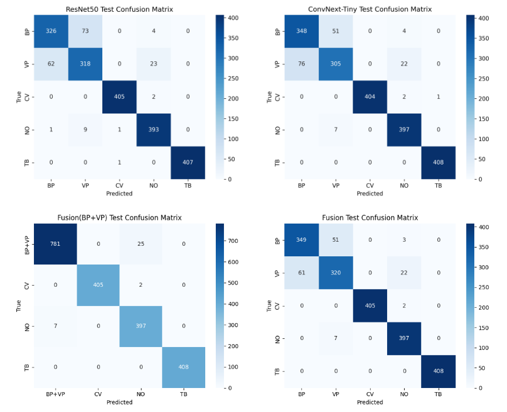
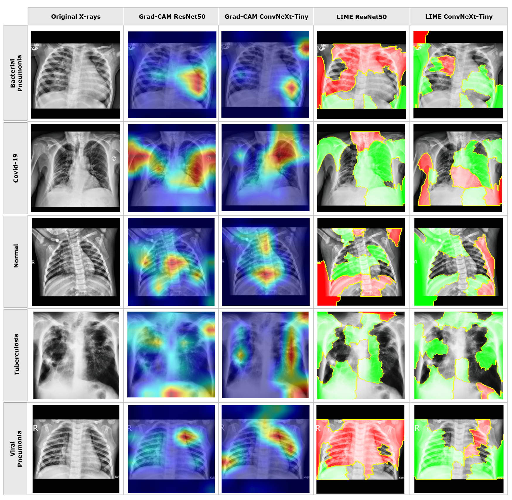
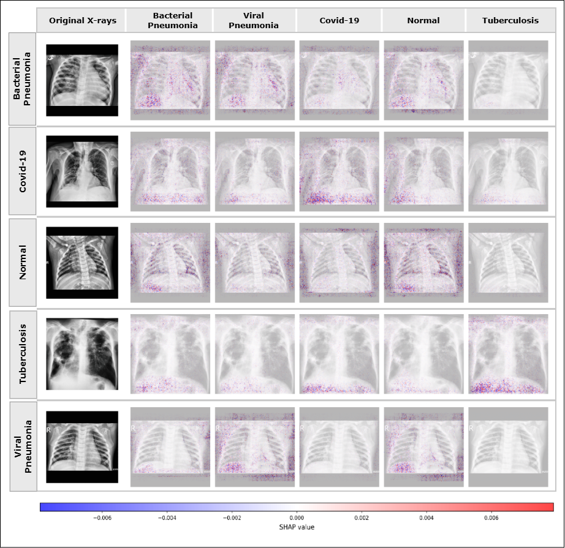

# Chest X-ray Disease Classification using Deep Learning and Ensemble Learning


> **Official implementation of a research project / manuscript currently under review**
> 
> The manuscript titled: **"Machine Learning Techniques for Disease Diagnosis: A Case Study on Pulmonary Disease Diagnosis"**
> 
> **Authors:** Vida Sadati, Soodeh Hosseini, Morteza Ghassed
> 
> **Affiliation:** Department of Computer Science, Faculty of Mathematics and Computer, Shahid Bahonar University of Kerman, Kerman, Iran
> Consultant Radiologist, Department of Interventional and Diagnostic Radiology, St. Johannes Hospital Dortmund, Germany  
> 

---

## Overview

This project investigates automated lung disease classification from chest X-ray images using multiple machine learning and deep learning approaches. It includes full pipeline development from preprocessing to advanced ensemble fusion.

### Key Contributions

- Classical ML vs Deep Learning comparison
- Multiple CNN architectures (from scratch + pretrained)
- Advanced training strategies (MixUp, EMA, label smoothing)
- Transfer learning with ResNet and ConvNeXt
- Validation-informed ensemble fusion
- Class-wise adaptive weighted soft fusion
- Four-class clinical evaluation (Pneumonia merging)
- Ablation study of ensemble fusion strategies
- Explainable AI analysis using Grad-CAM, LIME, and SHAP

---

## Classes

| Class | Description |
|---|---|
| BP | Bacterial Pneumonia |
| VP | Viral Pneumonia |
| CV | COVID-19 |
| NO | Normal |
| TB | Tuberculosis |

---

## Pipeline

### 1. Preprocessing

- Image resizing with aspect ratio preservation
- Padding-based resizing to 224 × 224 pixels
- CLAHE-based contrast enhancement
- RGB conversion
- Image normalization using ImageNet statistics

### 2. Data Augmentation

- Random rotation (±5 degrees)
- Brightness and contrast adjustments
- Random resized cropping (scale range: 0.92–1.00)
- Five augmented versions generated for each original training image
- Augmentation applied only to the training set

### 3. Models

- Decision Tree (baseline ML)
- SVM
- FFNN
- Simple CNN
- VGG16
- ResNet18
- ResNet50
- ConvNeXt-Tiny

### 4. Advanced Training Techniques

- Label smoothing
- Exponential Moving Average (EMA)
- Gradient clipping
- AdamW optimizer
- Early stopping based on validation Macro-F1

### 5. Ensemble Learning

- Validation-informed weighted soft fusion
- ResNet50 and ConvNeXt-Tiny probability aggregation
- Class-specific recall-based weighting
- Equal-weight soft fusion as a baseline
- Four-class evaluation through Pneumonia category merging

---

## Dataset

This project uses the following publicly available dataset:

**Kaggle Dataset:**  
[Lung Disease Dataset](https://www.kaggle.com/datasets/omkarmanohardalvi/lungs-disease-dataset-4-types)

A total of **10,095 chest X-ray images** were used in the experiments.

### Dataset Distribution

| Subset | Number of Images |
|---|---:|
| Training | 6,054 |
| Validation | 2,016 |
| Test | 2,025 |
| **Total** | **10,095** |

The original training, validation, and test subsets were maintained throughout the experiments.

## Experimental Results

### Table 1. Model Comparison

| Model | Accuracy (%) | Macro-F1 (%) |
|---|---:|---:|
| Decision Tree | 66.22 | 66.40 |
| SVM | 87.51 | 87.34 |
| FFNN | 86.47 | 86.28 |
| Simple CNN | 88.10 | 88.05 |
| VGG16 | 88.84 | 88.55 |
| ResNet18 | 89.88 | 89.78 |
| ResNet50 | 91.31 | 91.21 |
| ConvNeXt-Tiny | 91.95 | 91.81 |
| **Fusion Model** | **92.79** | **92.69** |

### Table 2. Class-wise Performance (F1-score %)

| Model | BP | VP | CV | NO | TB |
|---|---:|---:|---:|---:|---:|
| ResNet50 | 82.32 | 99.01 | 94.90 | 99.88 | 79.20 |
| ConvNeXt-Tiny | 84.16 | 99.51 | 95.16 | 99.88 | 79.63 |
| **Fusion** | **85.85** | **99.63** | **95.78** | **99.88** | **81.95** |

### Table 3. Ablation Study of Fusion Strategies

| Fusion Configuration | Accuracy (%) | Macro-F1 (%) |
|---|---:|---:|
| ResNet50 | 91.31 | 91.21 |
| ConvNeXt-Tiny | 91.95 | 91.81 |
| Equal-weight Soft Fusion | 92.49 | 92.35 |
| **Proposed Recall-weighted Soft Fusion** | **92.79** | **92.69** |

The proposed recall-weighted fusion achieved the highest accuracy and Macro-F1 score.

### Table 4. Four-Class Evaluation (BP + VP → Pneumonia)

| Model | Accuracy (%) | Macro-F1 (%) |
|---|---:|---:|
| **Fusion** | **98.32** | **98.41** |

Bacterial Pneumonia (BP) and Viral Pneumonia (VP) were merged into a single Pneumonia category.

> **Note:** The four-class evaluation is reported separately from the original five-class classification task. The higher performance reflects the change in class definitions rather than improved discrimination between bacterial and viral pneumonia.

## Confusion Matrices

The following confusion matrices represent model performance on the test set:

- ResNet50
- ConvNeXt-Tiny
- Five-class Fusion
- Four-class Fusion (Pneumonia-aware)

<p align="center">
  
</p>

---

## Explainable AI (XAI) Analysis

To investigate the features influencing deep learning predictions, three explainability methods were applied to ResNet50 and ConvNeXt-Tiny.

### 1. Grad-CAM

Gradient-weighted Class Activation Mapping (Grad-CAM) generates heatmaps highlighting image regions associated with a target class prediction.

### 2. LIME

Local Interpretable Model-agnostic Explanations (LIME) examines the influence of different image segments on individual predictions.

### 3. SHAP

SHapley Additive exPlanations (SHAP) estimates the contribution of input features to model predictions and generates class-specific attribution maps.

### Explainability Results

**Grad-CAM and LIME Visualizations**

<p align="center">
  
</p>

**SHAP Visualizations**

<p align="center">
  
</p>

> **Note:** Replace the image paths above with the actual filenames of the generated explainability figures.

These visualizations provide a qualitative assessment of model behavior. They do not establish clinical correctness or demonstrate that the models rely exclusively on medically meaningful image features.

---


## Key Findings

- ConvNeXt-Tiny and ResNet50 outperform classical ML models significantly.
- Ensemble fusion improves overall classification performance.
- Class-specific recall weighting provides better results than equal-weight fusion.
- The proposed fusion model achieves 92.79% accuracy and 92.69% Macro-F1.
- Merging BP and VP into a single Pneumonia category improves the four-class evaluation performance.
- Grad-CAM, LIME, and SHAP provide complementary perspectives on model predictions.
- Visual explanations reveal that some predictions may be influenced by image regions outside the lung fields.

---

## Limitations and Generalizability

Despite the promising experimental results, several limitations should be considered:

- The experiments were conducted using a single publicly available dataset.
- External and multicenter validation has not been performed.
- Explainability methods were evaluated qualitatively without comparison against expert annotations or radiologist assessments.
- No prospective clinical evaluation or clinician assessment was conducted.
- The results do not establish clinical readiness or suitability for real-world diagnostic deployment.

Further research should include external validation, expert evaluation of explainability results, and assessment under different clinical imaging conditions.

---

## Installation

Clone the repository:

```bash
git clone <YOUR_REPOSITORY_URL>
cd <YOUR_REPOSITORY_NAME>
```

Install the required dependencies:

```bash
pip install -r requirements.txt
```

---

## Usage

```bash
# Preprocessing
python src/preprocess_images.py

# Augmentation
python src/augment_images.py

# CNN training
python src/cnn.py

# Classical ML
python src/svm.py
python src/decision_tree.py
python src/FFNN.py

# Deep Models
python src/resnet50_advanced.py
python src/convnext_advanced.py

# Ensemble Evaluation
python src/VWSF.py
python src/VWMF.py
```

---

## Project Structure

```text
.
├── preprocessing/
│   ├── augment_images.py
│   └── preprocess_images.py
│
├── src/
│   ├── dataset.py
│   ├── cnn.py
│   ├── svm.py
│   ├── decision_tree.py
│   ├── FFNN.py
│   ├── vgg.py
│   ├── resnet18.py
│   ├── resnet50.py
│   ├── resnet50_advanced.py
│   ├── convnext.py
│   ├── convnext_advanced.py
│   ├── VWSF.py
│   └── VWMF.py
│
├── Image/
│   ├── Confusion.png
│   ├── GradCAM_LIME.png
│   └── SHAP.png
│
├── config.py
├── requirements.txt
└── README.md
```

---

## Reproducibility

- Experiments use predefined training, validation, and test subsets.
- Random seed settings are managed through `config.py`.
- Validation Macro-F1 is used for model checkpoint selection.
- Fusion weights are calculated exclusively using validation-set performance.
- The held-out test set is reserved for final model evaluation.

---

## Notes

- Designed for research and academic use only.
- Fully reproducible using `config.py` seed settings.
- Supports classical machine learning, deep learning, and ensemble learning pipelines.
- Optimized for medical image classification research tasks.
- Easily extendable to other radiology or medical imaging datasets.

---

## License

This repository is provided for academic and research purposes only.

No commercial use, redistribution, or modification is permitted without prior written permission from the author.
